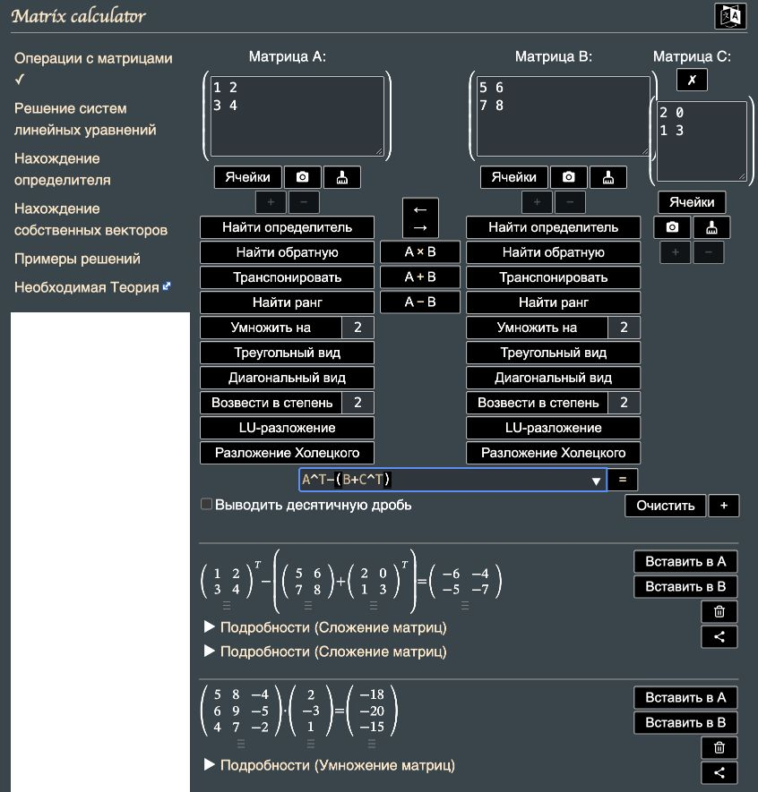

# Козарчук Никита ИТ-2 Лабораторная №3

Вариант 6. Массивы и файлы.

## Оглавление

- [Задание 1, задача 6](#задание-1)
- [Задание 2, задача 6](#задание-2)
- [Задание 3, задача 6](#задание-3)
- [Задание 4, задача 6](#задание-4)
- [Задание 5, задача 6](#задание-5)
- [Задание 6, задача 6](#задание-6)
- [Задание 7, задача 6](#задание-7)
- [Задание 8, задача 6](#задание-8)
- [Запуск](#запуск)

# Задание 1

## Задача 6

### Текст задачи

Первый массив размерностью n × m заполняется данными, вводимыми с клавиатуры, по столбцам от первых элементов столбца к последним.

Второй массив размерностью n × n заполняется четырёхзначными случайными числами, составленными из чётных цифр.

Третий массив размерностью n × n заполняется для произвольного n так же, как для n = 5:

```text
1 4 1 2 1
0 2 3 2 1
0 0 3 2 3
0 0 0 4 1
0 0 0 0 5
```

Заполнение реализовать конструкторами одного класса. Перегрузить `ToString()` для вывода массива в виде таблицы.

### Алгоритм решения

1. Создать класс `Matrix` с единственным полем `_values` типа `int[,]`.
2. Для первой матрицы запросить количество строк и столбцов. В конструкторе `Matrix(int rows, int columns)` создать массив указанного размера.
3. Выполнить внешний цикл по столбцам, внутренний — по строкам. Для каждого элемента запросить целое число с клавиатуры и записать его в массив.
4. Для второй матрицы использовать конструктор `Matrix(int size, Random random)`. Выбрать первую цифру из 2, 4, 6, 8, чтобы число было четырёхзначным.
5. Трижды умножить число на 10 и добавить случайную цифру из 0, 2, 4, 6, 8. Записать полученное число в очередную ячейку.
6. Для третьей матрицы использовать конструктор `Matrix(int size)`. Ниже главной диагонали оставить нули. При нумерации с нуля для `j >= i` записывать `i + 1`, если `j - i` чётно, иначе — `size - j`. Параллельные диагонали заполняются попеременно по возрастанию и убыванию; правило точно воспроизводит образец.
7. В `ToString()` найти максимальную длину текстового представления элемента. С помощью `StringBuilder` сформировать строки матрицы, выравнивая числа методом `PadLeft`.
8. В `Program.ShowMatrices()` создать и вывести три объекта через `Console.WriteLine`.

### Поля класса

| Поле | Тип | Назначение |
| --- | --- | --- |
| `Matrix._values` | `int[,]` | Двумерный массив элементов. Поле `readonly`: ссылка задаётся в конструкторе. |

Это единственное поле класса `Matrix`. Число строк и столбцов определяется через `GetLength`.

### Конструкторы, свойства и методы

- Конструктор `Matrix(int rows, int columns)` создаёт матрицу и заполняет её с клавиатуры по столбцам.
- Конструктор `Matrix(int size, Random random)` создаёт квадратную матрицу случайных четырёхзначных чисел из чётных цифр.
- Конструктор `Matrix(int size)` создаёт квадратную матрицу по образцу.
- Конструктор `Matrix(int[,] values)` создаёт копию переданного массива и используется при выполнении матричных операций.
- Свойства `Rows` и `Columns` возвращают размеры матрицы; содержат только `get`.
- Индексатор `this[int row, int column]` предоставляет доступ для чтения элемента.
- Метод `CheckSize()` отклоняет неположительные размеры; метод `ToString()` формирует табличное представление.

### Тестирование

Проверка 1. Ввести размеры 2 × 3 и числа 1, 2, 3, 4, 5, 6. Ввод идёт по столбцам, поэтому результат:

```text
1 3 5
2 4 6
```

Проверка 2. Для третьей матрицы задать n = 5. Получена матрица, полностью совпадающая с образцом из условия. При n = 1 получается единственный элемент 1.

Проверка 3. Проверены 900 случайных элементов матрицы 30 × 30: каждое число находится в диапазоне 1000–9999, каждая цифра чётная. Нулевой размер и нечисловой ввод отклоняются.

# Задание 2

## Задача 6

### Текст задачи

Найдите самый короткий путь между максимальным и минимальным элементами двумерного массива, если разрешается двигаться вправо, влево, вверх, вниз и по диагонали.

### Алгоритм решения

1. Считать размеры и элементы матрицы с клавиатуры через `Program.ReadMatrix()`.
2. В `Matrix.FindShortestPath()` одним обходом найти значения минимального и максимального элементов.
3. Повторным обходом собрать в два списка координаты всех вхождений минимума и максимума.
4. Для каждой пары координат вычислить число шагов: `max(abs(r1 - r2), abs(c1 - c2))`. За один шаг обе координаты могут измениться не более чем на единицу.
5. Выбрать пару с наименьшим числом шагов. При равенстве расстояний сохранить первую найденную пару при обходе по строкам.
6. Добавить клетку максимума в путь. Пока текущая клетка не совпадает с клеткой минимума, изменять каждую координату на знак разности с конечной координатой. Сначала движение идёт по диагонали, затем по оставшейся координате.
7. Вернуть список посещённых клеток. В `Program.ShowPath()` вывести координаты, значения элементов и количество шагов `path.Count - 1`.

### Поля класса

| Поле | Тип | Назначение |
| --- | --- | --- |
| `Matrix._values` | `int[,]` | Двумерный массив элементов. Поле `readonly`: ссылка задаётся в конструкторе. |

Это единственное поле класса `Matrix`. Число строк и столбцов определяется через `GetLength`.

Для координат используется `Point`: `X` хранит номер строки, `Y` — номер столбца. Списки координат и путь являются локальными переменными метода.

### Конструкторы, свойства и методы

- Конструктор `Matrix(int rows, int columns)` вводит исходную матрицу.
- Метод `FindShortestPath()` возвращает `List<Point>` с координатами пути от максимума к минимуму.
- Индексатор матрицы используется для вывода значений клеток пути.
- Метод `Program.ShowPath()` организует ввод и вывод результата.

### Тестирование

Проверка 1. Для матрицы:

```text
9 4 5
5 5 0
```

Получен путь `[0, 0] -> [1, 1] -> [1, 2]`. Количество шагов — 2. Координаты выводятся с нуля.

Проверка 2. При повторяющихся максимумах выбирается ближайший к минимуму. Для матрицы ниже путь идёт от `[2, 3]` к `[2, 2]` и содержит один шаг:

```text
9 5 5 5 5
5 5 5 5 5
5 5 0 9 5
```

Проверка 3. Для матрицы из одинаковых значений путь содержит одну клетку, число шагов равно нулю. На 100 случайных матрицах длина найденного пути совпала с результатом независимого поиска в ширину.

Сложность алгоритма — `O(N + p*q)`, где N — число элементов, p и q — количества максимумов и минимумов. Дополнительная память — `O(N)`.

# Задание 3

## Задача 6

### Текст задачи

Вычислить матричное выражение `Aᵀ − (B + Cᵀ)`. Перегрузить необходимые операторы; решение без перегрузки не принимается. В отчёт включить снимок проверки выражения на онлайн-калькуляторе.

### Алгоритм решения

1. Запросить количество строк r и столбцов c матриц A и C. Для согласованности выражения задать матрице B размер c × r.
2. Ввести элементы трёх матриц по столбцам.
3. Реализовать `Transpose()`: создать массив размера c × r и записать исходный элемент `[i, j]` в ячейку `[j, i]` нового массива.
4. Перегрузить операторы `+` и `-`. Перед выполнением операции проверить, что матрицы не равны `null` и имеют одинаковые размеры.
5. Вспомогательным методом `Combine()` выполнить поэлементное сложение или вычитание. Использовать `checked` для обнаружения переполнения Int32.
6. В методе `CalculateExpression()` вычислить `a.Transpose() - (b + c.Transpose())`. Операции возвращают новые матрицы, исходные объекты не изменяются.
7. В `Program.ShowExpression()` вывести исходные матрицы и результат. Повторить расчёт в онлайн-калькуляторе и сравнить результаты.

### Поля класса

| Поле | Тип | Назначение |
| --- | --- | --- |
| `Matrix._values` | `int[,]` | Двумерный массив элементов. Поле `readonly`: ссылка задаётся в конструкторе. |

Это единственное поле класса `Matrix`. Число строк и столбцов определяется через `GetLength`.

### Конструкторы, свойства и методы

- Метод `Transpose()` возвращает транспонированную матрицу.
- Перегруженные `operator +` и `operator -` реализуют сложение и вычитание матриц.
- Метод `Combine(Matrix a, Matrix b, bool subtract)` проверяет размеры и выполняет операцию.
- Статический метод `CalculateExpression(Matrix a, Matrix b, Matrix c)` вычисляет выражение варианта 6.
- Конструктор `Matrix(int[,] values)` копирует результирующий массив; метод `ToString()` формирует вывод.

### Тестирование

Проверка 1. Заданы матрицы:

```text
A = 1 2     B = 5 6     C = 2 0
    3 4         7 8         1 3

A^T - (B + C^T) = -6 -4
                   -5 -7
```

Порядок ввода: A — 1, 3, 2, 4; B — 5, 7, 6, 8; C — 2, 1, 0, 3.
Результат программы совпал с [Matrixcalc](https://matrixcalc.org/ru/).



Проверка 2. Транспонирование матрицы 2 × 3 возвращает матрицу 3 × 2 с правильным расположением элементов. При несовпадении размеров операндов возникает `ArgumentException`.

Проверка 3. Сложение `int.MaxValue` и 1 в элементах матриц вызывает `OverflowException`. Интерфейс сообщает о переполнении и возвращается в меню.

# Задание 4

## Задача 6

### Текст задачи

Переписать в другой файл последовательного доступа те элементы исходного бинарного файла, которые кратны k. Исходный файл заполнить случайными числовыми данными; заполнение организовать отдельным методом.

### Алгоритм решения

1. Запросить количество чисел, нижнюю и верхнюю границы случайного диапазона и ненулевой делитель k.
2. В `FileTasks.FillBinary()` открыть исходный файл через `BinaryWriter`. Сгенерировать указанное число значений и записать каждое как Int32.
3. Для включения верхней границы использовать `Random.NextInt64(min, (long)max + 1)`. Это позволяет задать весь диапазон Int32 без переполнения границы.
4. В `CopyMultiples()` открыть исходный файл через `BinaryReader`, результирующий — через `BinaryWriter`.
5. Последовательно читать числа до конца потока. Если `(long)value % k == 0`, записать число в результирующий файл. Приведение к long позволяет обработать `int.MinValue` и k = -1.
6. Закрыть потоки через `using`. Методом `PrintBinary()` вывести исходные числа и отобранные элементы в прежнем порядке.

### Поля класса

Статический класс `FileTasks` не содержит полей. Имена файлов и параметры обработки передаются в методы. Потоки, счётчики и результаты являются локальными переменными.

### Конструкторы, свойства и методы

- `FillBinary(string path, int count, int min, int max, Random random)` заполняет бинарный файл случайными числами.
- `CopyMultiples(string source, string target, int k)` последовательно копирует числа, кратные k.
- `PrintBinary(string path)` читает файл и выводит его элементы.
- `CheckDivisor(int k)` отклоняет нулевой делитель.
- `Program.WorkWithNumbers()` запрашивает параметры и вызывает методы задания 4.

### Тестирование

Проверка 1. Для чисел `-6, -1, 0, 3, 4, 9` и k = -3 получены `-6, 0, 3, 9`. Порядок сохранён; ноль является кратным любого ненулевого k.

Проверка 2. Для k = -1 значение `int.MinValue` обрабатывается без переполнения. Генерация 100 чисел из полного диапазона Int32 создаёт файл длиной 400 байт.

Проверка 3. При k = 0 требуется повторный ввод. При количестве чисел 0 создаются пустые исходный и результирующий файлы.

Файлы задания: `data/numbers.bin`, `data/multiples.bin`.

# Задание 5

## Задача 6

### Текст задачи

Файл содержит сведения об игрушках: название игрушки, стоимость в рублях и возрастные границы, например от двух до пяти лет. Определить стоимость самого дорогого конструктора.

Данные представить структурой `struct`. Заполнение исходного файла организовать отдельным методом. Обязательно использовать XML-сериализацию.

### Алгоритм решения

1. Создать публичную структуру `Toy` с полями названия, цены и двух возрастных границ. Свойства реализовать явно через поля, без автосвойств.
2. Запросить число игрушек. Для каждой ввести непустое название, неотрицательную цену не более чем с двумя знаками дроби и возрастные границы от 0 до 150 лет. Верхняя граница не должна быть меньше нижней.
3. Создать массив `Toy[]`. В отдельном методе `FillToys()` записать его в бинарный файл: сначала количество записей, затем для каждой — название, цену, минимальный и максимальный возраст.
4. В том же методе создать `XmlSerializer` для `Toy[]` и сериализовать массив в XML-файл. Так соблюдены требования к бинарному файлу структур и обязательной XML-сериализации.
5. Прочитать записи из бинарного файла через `ReadToysBinary()`. Десериализовать XML в массив структур через `ReadToysXml()` и проверить восстановленные значения.
6. Для каждого массива вызвать `FindConstructorPrice()`. Сравнивать название со словом «конструктор» без учёта регистра и крайних пробелов. Выбрать наибольшую цену среди совпадений.
7. Вывести цену, найденную по каждому файлу. Если конструктора нет, вывести отдельное сообщение. Признак found позволяет отличить отсутствие конструктора от нулевой цены.

### Поля класса

Класс `FileTasks` не содержит полей. Сведения об игрушке хранятся в структуре `Toy`.

| Поле | Тип | Назначение |
| --- | --- | --- |
| `Toy._name` | `string` | Название игрушки. |
| `Toy._price` | `decimal` | Стоимость в рублях. |
| `Toy._minAge` | `int` | Минимальный рекомендуемый возраст. |
| `Toy._maxAge` | `int` | Максимальный рекомендуемый возраст. |

### Конструкторы, свойства и методы

- Конструктор `Toy(string name, decimal price, int minAge, int maxAge)` проверяет и сохраняет сведения об игрушке.
- Свойства `Name`, `Price`, `MinAge`, `MaxAge` имеют явно написанные `get` и `set`. Публичные свойства используются `XmlSerializer`.
- `FillToys(string binaryPath, string xmlPath, Toy[] toys)` сохраняет массив в бинарный и XML-файлы.
- `ReadToysBinary(string path)` восстанавливает массив из бинарного файла.
- `ReadToysXml(string path)` десериализует XML и проверяет значения полей.
- `FindConstructorPrice(Toy[] toys, out decimal price)` возвращает признак нахождения конструктора и его максимальную цену через `out`.
- `Program.WorkWithToys()` организует ввод, запись, чтение и вывод результата.

### Тестирование

Проверка 1. Введены записи:

| Название | Цена, руб. | Возраст |
| --- | --- | --- |
| Конструктор | 100,00 | 2–5 |
| Мяч | 999,00 | 0–10 |
| конструктор | 250,50 | 6–12 |

Результат из обоих файлов: самый дорогой конструктор стоит 250,50 руб.
Возрастные границы и остальные поля сохраняются после чтения бинарного файла и XML-десериализации.

Проверка 2. Пустой массив не содержит конструктора. Запись «конструктор» с ценой 0 считается найденной. Название «Конструктор LEGO» не является точным совпадением со словом «конструктор».

Проверка 3. Пустое название, отрицательная цена, цена с тремя дробными знаками и верхний возраст меньше нижнего отклоняются. Для цены допускаются точка и запятая.

Файлы задания: `data/toys.bin`, `data/toys.xml`.

# Задание 6

## Задача 6

### Текст задачи

В текстовом файле хранятся целые числа по одному в строке. Найти сумму тех элементов файла, которые равны своему индексу. Индексацию элементов начинать с нуля. Исходный файл заполнить случайными данными отдельным методом.

### Алгоритм решения

1. Запросить количество чисел и границы случайного диапазона.
2. Вызвать `FillText()` с параметром `perLine = 1`: записать каждое случайное число на отдельной строке файла UTF-8.
3. В `SumAtIndex()` открыть файл через `StreamReader`, задать индекс 0 и сумму 0.
4. Последовательно читать строки. Преобразовать строку в Int32 через `ParseNumber()`. Если преобразование невозможно, сообщить об ошибке данных файла.
5. Если число равно текущему индексу, добавить его к сумме типа long. После каждой строки увеличить индекс на 1.
6. Вернуть сумму и вывести её через `Program.WorkWithNumbers()`. Для пустого файла вернуть 0.

### Поля класса

Статический класс `FileTasks` не содержит полей. Имена файлов и параметры обработки передаются в методы. Потоки, счётчики и результаты являются локальными переменными.

### Конструкторы, свойства и методы

- `FillText(string path, int count, int min, int max, int perLine, Random random)` формирует случайные данные; в задании 6 `perLine` равен 1.
- `SumAtIndex(string path)` возвращает сумму типа `long` для элементов, равных своему индексу.
- `ParseNumber(string text)` проверяет, что строка содержит число Int32.
- `Program.WorkWithNumbers()` запрашивает параметры и выводит файл и сумму.

### Тестирование

Проверка 1. Файл содержит:

```text
0
1
9
3
4
```

Значения совпадают с индексами 0, 1, 3 и 4. Полученная сумма — `0 + 1 + 3 + 4 = 8`.

Проверка 2. Через меню задать количество 5 и диапазон от 3 до 3. В файле пять троек; только число с индексом 3 совпадает с индексом. Результат — 3.

Проверка 3. Для пустого файла сумма равна 0. Нечисловой ввод количества и неверные границы диапазона требуют повторного ввода.

Файл задания: `data/index.txt`.

# Задание 7

## Задача 6

### Текст задачи

В текстовом файле хранятся целые числа по несколько в строке. Вычислить произведение элементов, которые кратны заданному числу k. Исходный файл заполнить случайными данными отдельным методом.

### Алгоритм решения

1. Запросить количество чисел, границы случайного диапазона, число значений в строке от 2 до 100 и ненулевой делитель k.
2. В `FillText()` записать случайные числа в UTF-8, разделяя числа пробелами и завершая строку после заданного количества. Последняя строка может быть короче.
3. В `ProductMultiples()` задать произведение `BigInteger.One` и признак found = false. Тип `BigInteger` позволяет вычислять результат за пределами Int64.
4. Открыть файл через `StreamReader`. Каждую строку разделить по пробельным символам с удалением пустых частей.
5. Преобразовать каждую часть в Int32. Если `(long)value % k == 0`, умножить произведение на число и установить found = true.
6. Вернуть found, а произведение передать через `out`. Если подходящих чисел нет, вывести сообщение «Кратных элементов нет». Если среди них есть 0, результат равен 0.

### Поля класса

Статический класс `FileTasks` не содержит полей. Имена файлов и параметры обработки передаются в методы. Потоки, счётчики и результаты являются локальными переменными.

### Конструкторы, свойства и методы

- `FillText()` заполняет файл случайными числами, по несколько чисел в строке.
- `ProductMultiples(string path, int k, out BigInteger product)` вычисляет произведение и возвращает признак наличия кратных элементов.
- `CheckDivisor(int k)` запрещает k = 0; отрицательные значения допустимы.
- `ParseNumber(string text)` проверяет отдельное число из строки.
- `Program.WorkWithNumbers()` организует ввод, создание файла и вывод результата.

### Тестирование

Проверка 1. Для файла:

```text
2 -3 6
9 5
```

При k = 3 получено произведение `(-3) * 6 * 9 = -162`.

Проверка 2. Через меню задать 4 числа, диапазон от 6 до 6, по 2 числа в строке и k = 3. Получен результат `6⁴ = 1296`. Произведение трёх чисел 2000000000 также вычисляется верно, хотя превышает Int64.

Проверка 3. Для чисел 1, 5, 7 и k = 2 выводится сообщение об отсутствии кратных. Для чисел 0, 6 и k = 3 результат равен 0. При k = 0 требуется повторный ввод.

Файл задания: `data/product.txt`.

# Задание 8

## Задача 6

### Текст задачи

В текстовом файле хранится текст. Переписать в другой файл строки, в которых нет русских букв.

### Алгоритм решения

1. Запросить количество строк. Ввести строки с клавиатуры, разрешая пустые строки.
2. В `FillLines()` сохранить введённый массив строк в исходный файл UTF-8.
3. В `CopyWithoutRussian()` открыть исходный файл через `StreamReader`, результирующий — через `StreamWriter`.
4. Читать файл по строкам. Для каждой строки установить признак hasRussian = false.
5. Перебрать символы строки. Если символ находится в диапазоне от «А» до «я» или равен «Ё» либо «ё», установить hasRussian = true и завершить проверку строки. Буквы Ё и ё проверяются отдельно, потому что находятся вне указанного диапазона Unicode.
6. Если русских букв нет, записать строку в результирующий файл. Сохранить порядок строк. Пустая строка подходит под условие.
7. Закрыть потоки через `using` и вывести содержимое результирующего файла.

### Поля класса

Статический класс `FileTasks` не содержит полей. Имена файлов и параметры обработки передаются в методы. Потоки, счётчики и результаты являются локальными переменными.

### Конструкторы, свойства и методы

- `FillLines(string path, string[] lines)` записывает строки, введённые пользователем, в исходный файл.
- `CopyWithoutRussian(string source, string target)` копирует только строки без букв русского алфавита.
- `ConsoleInput.ReadLine()` читает строку, в том числе пустую; завершение входного потока обрабатывается отдельно.
- `Program.WorkWithLines()` запрашивает строки и выводит результат.

### Тестирование

Проверка 1. Ввести строки Hello, Ёж, 123, пустую строку, world. В результирующем файле сохраняются Hello, 123, пустая строка и world.

Проверка 2. Строки «Ёж», «ёж», «АБВ» и «я» исключаются. Строка «é» сохраняется: проверяются именно русские буквы, а не все буквы любого алфавита.

Проверка 3. При нулевом количестве строк создаются пустые исходный и результирующий файлы.

Файлы задания: `data/lines.txt`, `data/without_russian.txt`.

# Запуск

Требуется [.NET SDK 10](https://dotnet.microsoft.com/download/dotnet/10.0).

```bash
git clone https://github.com/Quiniful/lab3_csharp.git
cd lab3_csharp
dotnet run --project Lab3.csproj
```

Либо открыть `Lab3.slnx` в Rider или Visual Studio с поддержкой .NET 10.

Для проверки сборки и форматирования:

```bash
dotnet build Lab3.csproj
dotnet format Lab3.csproj whitespace --verify-no-changes --no-restore
```
